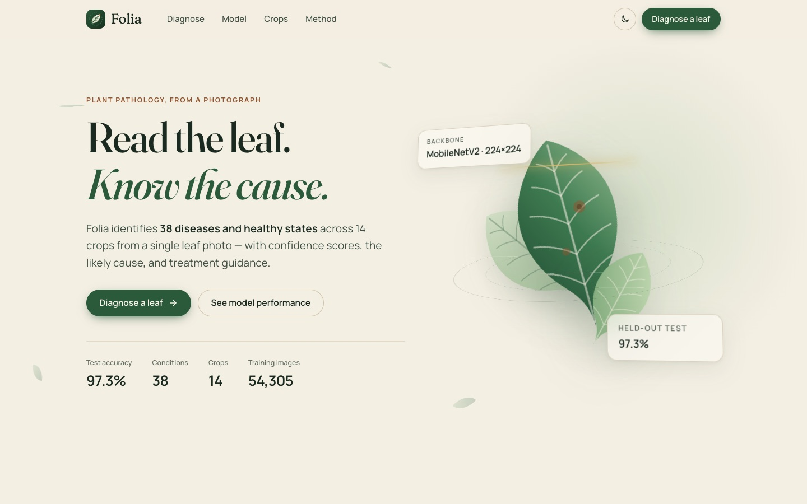
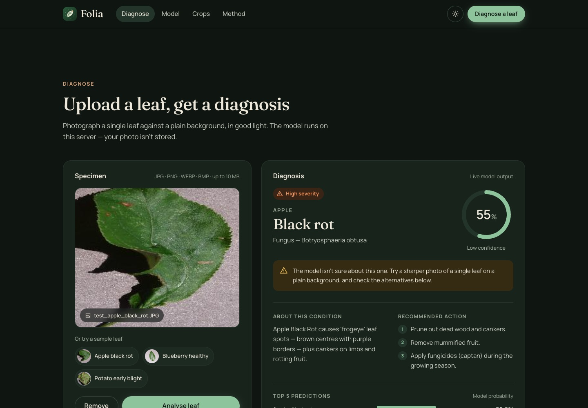

# Folia — Plant Disease Detection

*Read the leaf. Know the cause.*

Folia identifies 38 plant diseases and healthy states across 14 crops from a single leaf photo. It's a deep learning model served through a Flask web app that shows the prediction, confidence, likely cause and treatment guidance.




- **Model:** MobileNetV2 pretrained on ImageNet and fine-tuned on colour PlantVillage images, with data augmentation and dropout
- **Data:** [PlantVillage](https://www.kaggle.com/datasets/abdallahalidev/plantvillage-dataset), about 54k images split 70 / 15 / 15 into train / validation / test, with each class split in the same proportions
- **Test accuracy: 97.3%** on 8,129 held-out images (full results in `metrics.json`)

## Web app features

- Drag-and-drop or keyboard upload, plus one-click sample leaves. Every result is a real model prediction.
- Confidence gauge, severity, cause, description, step-by-step treatment and the top 5 alternatives
- A low-confidence warning when the model is less than 60% sure
- Model performance charts built from `metrics.json`: accuracy against the original baseline, the dataset split, and per-condition accuracy with crop filtering and a table view
- Responsive layout, light and dark themes, keyboard and screen-reader support, and reduced motion when the visitor's system asks for it

## Project structure

```
train.py                 training script (writes the model, class_indices.json, metrics.json)
app.ipynb                original exploration notebook (baseline CNN)
flask_app/app.py         web backend: /predict, /classes, /model-info, /samples
flask_app/static/        frontend (index.html, css/, js/, img/)
class_indices.json       index → class name
test_images_cnn/         sample images for a quick check
```

## Setup

```bash
python -m venv .venv && source .venv/bin/activate
pip install -r requirements.txt
# Apple Silicon GPU (optional): pip install tensorflow-metal
```

## Train

You need a Kaggle API token, saved as `~/.kaggle/kaggle.json` or set as `KAGGLE_USERNAME` / `KAGGLE_KEY`.

```bash
python train.py --download                 # download the dataset and train
python train.py --data-dir path/to/color   # or use a copy you already have
```

## Run the web app

```bash
cd flask_app
python app.py              # http://localhost:5050 (use the Python where requirements are installed)
```

## Results

| Model | Input | Accuracy |
|---|---|---|
| Baseline CNN (2 conv layers, `app.ipynb`) | grayscale | 79.5% validation (train 98.6%, overfitting) |
| MobileNetV2 transfer learning (`train.py`) | colour | **97.3% test** (97.1% validation) |

Weakest classes on the test set: Tomato Early blight (70.7%), Corn Cercospora leaf spot (76.3%), Potato healthy (81.8%).

## Limitations

PlantVillage photos show single leaves on a plain background. Accuracy on photos taken in the field, with cluttered backgrounds and uneven lighting, will be lower.
